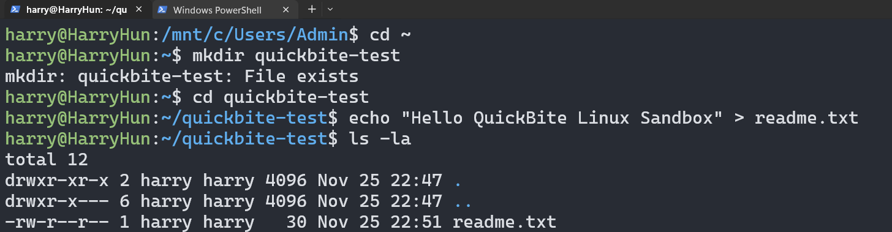
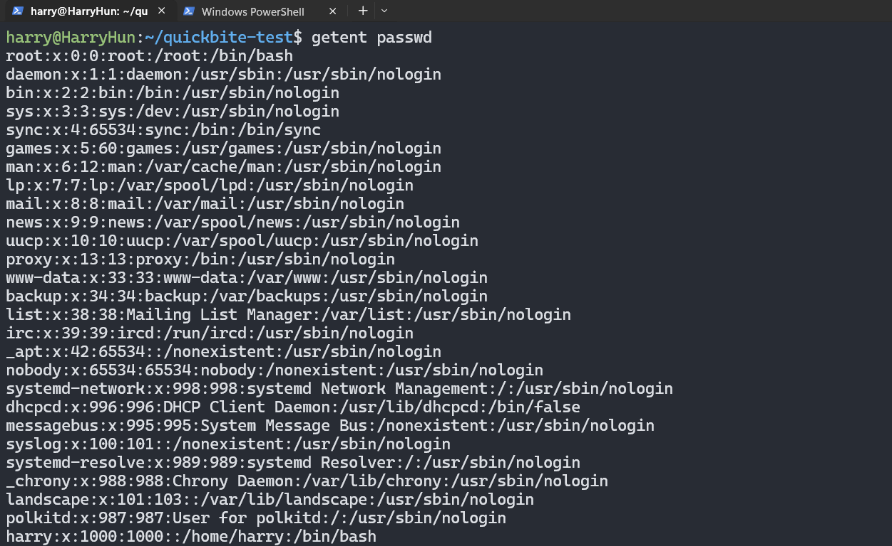

# 🐧 Báo Cáo Thực Hành: Thao Tác File & Quản Trị User/Group trên Linux CLI

> **Môn học:** Quản trị Hệ thống & Triển khai Linux / DevOps  
> **Bài tập:** Session 01 - Exercise 02: Làm quen CLI Linux - Thao tác file và kiểm tra User/Group  
> **Sinh viên thực hiện:** Hà Thúc Quốc Hùng  
> **Môi trường thực nghiệm:** Ubuntu (WSL 2 trên Windows 11)  

---

## 📌 1. Mục Tiêu Bài Tập
- Nắm vững và thực hành thuần thục các lệnh điều hướng thư mục, tạo file và kiểm tra thuộc tính, quyền hạn tập tin trên môi trường dòng lệnh Linux.
- Truy vấn, phân tích danh sách tài khoản người dùng (users) và nhóm người dùng (groups) trực tiếp từ các file cấu hình hệ thống Linux (`/etc/passwd`, `/etc/group`).

---

## 🛠️ 2. Các Bước Thực Hiện & Lệnh Thao Tác

### 2.1. Thao tác với thư mục và tập tin
1. **Di chuyển về thư mục Home của người dùng:**
   ```bash
   cd ~
   ```
2. **Khởi tạo thư mục thực hành `quickbite-test`:**
   ```bash
   mkdir -p quickbite-test
   cd quickbite-test
   ```
3. **Tạo tập tin `readme.txt` và ghi nội dung:**
   ```bash
   echo "Hello QuickBite Linux Sandbox" > readme.txt
   ```
4. **Kiểm tra chi tiết thuộc tính tập tin (bao gồm file ẩn):**
   ```bash
   ls -la
   ```
   *Kết quả hiển thị:*
   ```text
   total 12
   drwxr-xr-x 2 harry harry 4096 Nov 25 22:47 .
   drwxr-x--- 6 harry harry 4096 Nov 25 22:47 ..
   -rw-r--r-- 1 harry harry   30 Nov 25 22:47 readme.txt
   ```
   - **Giải thích thuộc tính `readme.txt`:**
     - Loại file & Quyền: `-rw-r--r--` (File thường; Owner có quyền Read/Write; Group & Others chỉ có quyền Read).
     - User sở hữu: `harry`.
     - Group sở hữu: `harry`.
     - Kích thước: `30 bytes`.

---

### 2.2. Kiểm tra danh sách User và Group hệ thống

1. **Truy vấn danh sách User từ hệ thống:**
   ```bash
   getent passwd
   # Hoặc: cat /etc/passwd
   ```
   *Cấu trúc một dòng thông tin user:*  
   `username:password:UID:GID:User_Info:Home_Directory:Default_Shell`  
   *Ví dụ tài khoản thực tế:*  
   `harry:x:1000:1000::/home/harry:/bin/bash`

2. **Truy vấn danh sách Group từ hệ thống:**
   ```bash
   getent group
   # Hoặc: cat /etc/group
   ```
   *Cấu trúc một dòng thông tin group:*  
   `group_name:password:GID:user_list`

---

## 📸 3. Kết Quả Kiểm Thử (Hình Ảnh Minh Chứng)

### 3.1. Danh sách file và phân quyền (`ls -la`)


### 3.2. Danh sách User trên hệ thống (`getent passwd`)


---

## 📂 4. Cấu Trúc Thư Mục Nộp Bài

```text
.
├── README.md
├── ls_la.png
├── getent_passwd.png
└── homework/
    └── session_01/
        └── exercise_02/
            ├── ls_la.png
            └── users_list.png       <-- Đường dẫn nộp bài chuẩn theo yêu cầu
```

---

## 🎯 5. Kết Luận
- Đã hoàn thành các thao tác quản trị thư mục, tạo file, cấp quyền cơ bản trên CLI Linux.
- Hiểu rõ cơ chế lưu trữ và quản lý người dùng, nhóm người dùng của hệ điều hành Linux thông qua `passwd` và `group`.
